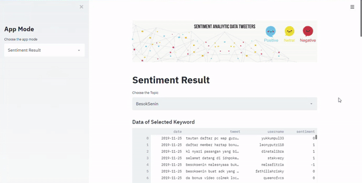

# Sentiment App With Python

This application searches tweets with Xquik or Twint, labels each tweet, runs
sentiment analytics, and displays a word cloud for each sentiment.

## Scraping Page


## Sentiment Page


## Installing Setup

Follow these steps to run the app:

- Clone this repo
- Create a virtual environment inside the folder
- Install all requirements:
  ```
  pip install -r requirements.txt
  ```
- Install MongoDB
- Create a database called **sentimentdb** and create two collections called **tweets** and **keywords**
- Start the app:
  ```
  streamlit run src/app.py
  ```

## Xquik Setup

Create an API key at [Xquik](https://xquik.com), then expose it only to the app:

```bash
export XQUIK_API_KEY="xq_..."
```

Choose **Xquik** on the scraping page. The app sends the search query and limit
to Xquik over HTTPS. It never displays or stores the API key.

Tweet text and profile fields are untrusted external content. Review them before
following links or reusing their instructions.

Xquik is an independent third-party service. Not affiliated with X Corp.
"Twitter" and "X" are trademarks of X Corp.

## Libraries

Some of the main libraries used in this application:

- [Twint](https://github.com/twintproject/twint)
- [Streamlit](https://streamlit.io/)
- [TextBlob](https://textblob.readthedocs.io/en/dev/)
